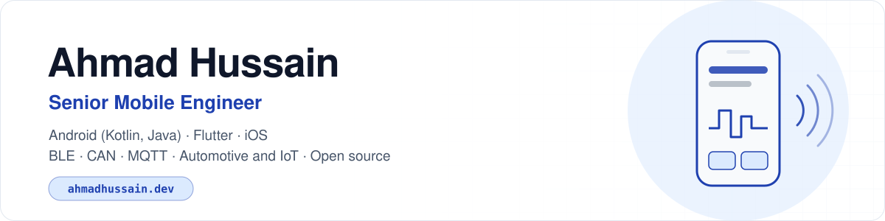

<picture>
  <source media="(prefers-color-scheme: dark)" srcset="assets/banner-dark.svg">
  
</picture>

  
  
  
  
  

I build production mobile apps for connected products: vehicles, industrial IoT devices and smart homes. My work covers Bluetooth Low Energy and CAN communication, MQTT telemetry, Clean Architecture on Android and Flutter, and releases to Google Play and the App Store. I also publish open-source Flutter and TypeScript packages for BLE, CAN bus, privacy and analytics.

Based in Islamabad, Pakistan. Open to remote roles with international teams.

| 9+ years | 5+ years | 3,000+ | 10,000+ | Team of 5 |
|:---:|:---:|:---:|:---:|:---:|
| Android (Kotlin, Java) | Flutter | automated tests authored | active users on a telemedicine app | led on a three-app delivery platform |

## Open source

| Package | Registry | What it does |
|:---|:---|:---|
| [**ble_keeper**](https://github.com/Ahmadhussain0335/ble_keeper) | [pub.dev](https://pub.dev/packages/ble_keeper) | Flutter plugin that keeps BLE devices connected in the background, after process death and after reboot, on Android and iOS |
| [**can_bus_toolkit**](https://github.com/Ahmadhussain0335/can_bus_toolkit) | [pub.dev](https://pub.dev/packages/can_bus_toolkit) | USB CAN adapters on Android with ISO-TP, OBD-II, UDS and DBC signal decoding |
| [**compliance_kit**](https://github.com/Ahmadhussain0335/compliance_kit) | [pub.dev](https://pub.dev/packages/compliance_kit) | PII-redacting logger, GDPR consent and data export, Play Integrity and App Attest with one audit trail (beta) |
| [**mobile-dev-kit**](https://github.com/Ahmadhussain0335/mobile-dev-kit) | [npm](https://www.npmjs.com/package/mobile-dev-kit) · [pub.dev](https://pub.dev/packages/mobile_dev_kit) | 19 Agent Skills for Android, iOS and Flutter teams: code review, OWASP MASVS, EU compliance and release |
| [**trackplan**](https://github.com/Ahmadhussain0335/trackplan) | [npm](https://www.npmjs.com/package/trackplan) · [pub.dev](https://pub.dev/packages/trackplan) | Type-safe analytics code for Dart and TypeScript from one YAML tracking plan |
| [**EyeControl**](https://github.com/Ahmadhussain0335/EyeMotionDetection) | GitHub | Hands-free Android control with eye and head gestures, using on-device ML Kit |
| [**CANBus OTG Debugger**](https://github.com/Ahmadhussain0335/Android-CANBus-OTG-Debugger) | GitHub | Android app to monitor, decode and debug CAN traffic over USB OTG |

## Shipped apps

| App | Client and domain | What I built | Links |
|:---|:---|:---|:---|
| **NX NextHMI** | Arnold NextG, automotive | Flutter vehicle-control gateway: UI generated from XML configuration, live CAN data over BLE via platform channels | [App Store](https://apps.apple.com/us/app/nx-nexthmi/id6738198334) · [Google Play](https://play.google.com/store/apps/details?id=com.arnoldnextg.android) |
| **Connected Logger** | MRS Electronic, automotive | Android app for an ECE/RED-certified CAN and LIN data logger: BLE pairing, live CAN signals, GPS and MQTT | [Google Play](https://play.google.com/store/apps/details?id=com.mrs.gateway) · [App Store](https://apps.apple.com/app/conn-logger/id1584295929) |
| **MTronic** | Smart home, IoT | Android app with BLE provisioning, nRF Mesh, OTA firmware updates and AWS Amplify / Cognito | [Google Play](https://play.google.com/store/apps/details?id=com.mtronic.smarthome) |
| **Mafell ZAS** | MAFELL AG, construction tech | Offline-first Flutter roof-tile cutting calculator with cutting-angle algorithms on Canvas | [Google Play](https://play.google.com/store/apps/details?id=com.mafell.zas) · [App Store](https://apps.apple.com/at/app/mafell-zas/id6745941412) |
| **Mia Vitals** | AI Nexus Healthcare, telemedicine | Flutter app with 10,000+ active users: camera-based vital signs and live clinician dashboards | [miavitals.com](https://www.miavitals.com/) |
| **FoodRunner** | Eikon7, food delivery | Customer, Rider and Restaurant apps in Java and MVVM; led the team of five | [Customer](https://apkpure.com/foodrunner-speedy-food-delivery/com.app.FoodRunner) · [Rider](https://apkpure.com/fr-rider/com.app.foodrunnerdriver) · [Restaurant](https://apkpure.com/fr-restaurant/com.app.resturantfoodrunnerapps) |

Case studies and screenshots: [ahmadhussain.dev](https://ahmadhussain.dev/#projects)

## Tech stack

  

| Area | Tools |
|:---|:---|
| Android | Kotlin, Java, Jetpack Compose, Coroutines and Flow, Room, WorkManager, Hilt, Dagger, Koin |
| Flutter and iOS | Dart, BLoC, GetX, Provider, platform channels, Pigeon, CustomPainter, Drift; Swift, SwiftUI, Combine |
| Connected devices | BLE (GATT, secure pairing, reconnection, OTA), CAN bus (J1939), OBD-II, UDS, nRF Mesh, MQTT, USB OTG |
| Architecture and quality | Clean Architecture, MVVM, MVI, SOLID; JUnit, Mockito, MockK, Espresso, UI Automator, TDD |
| Security and compliance | OAuth 2.0, JWT, SSL pinning, encrypted storage, R8; OWASP MASVS, GDPR, Cyber Resilience Act, EN 18031 |
| Delivery | Fastlane, GitHub Actions, GitLab CI, Jenkins, code signing, Google Play Console, App Store Connect |

## Experience

| Period | Role | Company |
|:---|:---|:---|
| Apr 2021 – present | Senior Software Engineer | MRS Technologies, Islamabad |
| Aug 2022 – Mar 2024 | Senior Mobile Developer | AI Nexus Healthcare, remote (US) |
| Oct 2018 – Apr 2021 | Team Lead, Mobile Development | Eikon7 Creative, Islamabad |
| Dec 2017 – Jul 2022 | Mobile and Web Developer (freelance) | Fiverr |
| May 2017 – Oct 2018 | Junior Android Developer | Codemaze, Rawalpindi |
| Feb 2017 – May 2017 | Android Developer (internship) | Softgrip Tech, Islamabad |

**Education:** MSc Data Science, SZABIST (2019–2021) · BSc Computer Science (Software Engineering), Federal Urdu University (2014–2018)
**Certifications:** Claude Code 101, Claude Code in Action, Introduction to Agent Skills (Anthropic) · Generating Effective Prompts for AI (IBM)

---

  <a href="https://ahmadhussain.dev">ahmadhussain.dev</a> ·
  <a href="https://www.linkedin.com/in/ahmad-hussain-b3268a15a/">LinkedIn</a> ·
  <a href="mailto:ahmadhussain0335@gmail.com">ahmadhussain0335@gmail.com</a>

